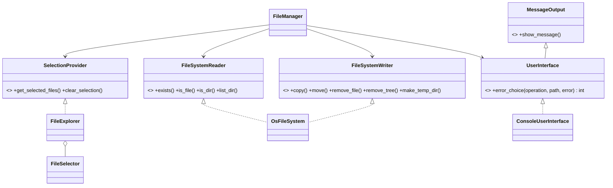

# Atelier 1 - Testabilité d'une classe

Gestionnaire de fichiers en console (`fmgr.py`) refactorisé pour rendre `FileManager` testable.

## Équipe

- Xavier Sanchez ([@xaviersanc](https://github.com/xaviersanc))
- Emma Gailledrat ([@EmmaDotCom](https://github.com/EmmaDotCom))
- Alexandre Sanchez ([@sonical0](https://github.com/sonical0))
- Kilian Carasco ([@Vador634](https://github.com/Vador634))

## Lancer

```bash
python fmgr.py              # application console
python -m unittest -v       # tests unitaires
```

## Étapes (une par commit)

1. **Refactorisation** : l'exploration (répertoire courant, affichage, navigation, sélection) est sortie de `FileManager` vers une nouvelle classe `FileExplorer`. `FileManager` ne garde que les traitements (copie, déplacement, suppression).
2. **Dépendances** : inversion de contrôle. `FileManager` reçoit par son constructeur des interfaces au lieu d'utiliser directement `os`, `shutil`, `FileExplorer` et la console :
   - `SelectionProvider` (implémentée par `FileExplorer`)
   - `FileSystemReader` / `FileSystemWriter` (implémentées par `OsFileSystem`)
   - `UserInterface` (implémentée par `ConsoleUserInterface`)

   Principes SOLID respectés : **L** (implémentations réelles et doublures de test interchangeables), **I** (interfaces petites, lecture et écriture séparées), **D** (`FileManager` dépend d'abstractions ; seul `main_menu()` choisit les implémentations concrètes).
   Les tests (`test_fmgr.py`) injectent un système de fichiers en mémoire et une interface utilisateur scriptée : aucun fichier réel n'est touché.
3. **Évolutions** : en cas d'erreur sur un fichier (E/S, fichier inexistant, verrouillé…), `FileManager` appelle `UserInterface.error_choice(operation, path, error)`, qui renvoie :
   - `0` : ignorer l'erreur et continuer
   - `1` : toujours ignorer les erreurs (jusqu'à la fin de l'opération en cours)
   - `2` : stopper l'opération en cours (ce qui est déjà fait est conservé)
   - `3` : annuler l'opération en cours avec **rollback** (copies supprimées, fichiers déplacés remis à leur place, fichiers supprimés restaurés : ils passent d'abord par une corbeille temporaire, vidée à la fin de l'opération)

## Diagramme de classes


